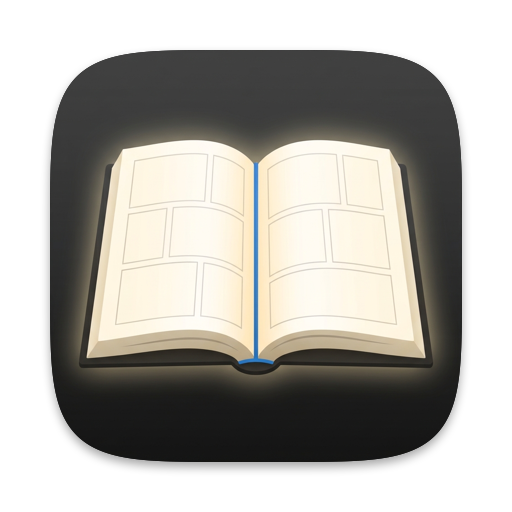

<p align="center">
  
</p>

# YomiView

macOS 向けの画像・漫画ビューア。フォルダや ZIP / CBZ を「本」として開き、ページ単位で閲覧します。

Windows 向け画像ビューア [NeeView](https://github.com/neelabo/NeeView) の中核機能を参考に、Swift / SwiftUI で新たに実装しています（詳細は [NOTICE.md](NOTICE.md)）。

## 動作環境

- macOS 14 以降
- Xcode（Swift 5.9 以降）

## ビルド

```sh
open YomiView.xcodeproj   # Xcode で開いて ⌘R
```

コマンドラインでビルド・テストする場合：

```sh
xcodebuild -project YomiView.xcodeproj -scheme YomiView -destination 'platform=macOS' test
```

プロジェクトファイルは [XcodeGen](https://github.com/yonaskolb/XcodeGen) で `project.yml` から生成しています。ファイルを追加・削除した場合やプロジェクト設定を変える場合は、`project.yml` を編集してから次を実行してください。

```sh
brew install xcodegen
xcodegen generate
```

## 手動確認手順

### Phase 0：起動

1. Xcode で `YomiView.xcodeproj` を開き、⌘R で実行する
2. 黒い空のウィンドウが表示され、中央に「フォルダ、ZIP、CBZ を開いてください」と「開く…」ボタンが出ることを確認する

### Phase 1：フォルダと ZIP / CBZ の閲覧（1ページ表示）

準備：ファイル名に数字を含む画像（例：`page1.png`, `page2.png`, `page10.png`, `page11.png`）を入れたフォルダを用意し、
Finder でそのフォルダを右クリック →「圧縮」して ZIP も作る。CBZ は ZIP の拡張子を `.cbz` に変えたものでよい。

1. ファイル ▸ 開く…（⌘O）でダイアログが開くことを確認する。ウィンドウ中央の「開く…」ボタンでも同じダイアログが開く
2. フォルダを選んで開き、1ページ目（`page1`）が表示され、ウィンドウタイトルが `フォルダ名 (1 / 4)` になることを確認する
3. → キーで `page1 → page2 → page10 → page11` の順（自然順）に進むことを確認する
4. 最後のページで → を押しても何も起きない（タイトルが `(4 / 4)` のまま）ことを確認する
5. ← キーで戻れること、1ページ目で ← を押しても何も起きないことを確認する
6. 同じ手順を ZIP と CBZ でも行う。Finder で作った ZIP に含まれる `__MACOSX` フォルダの画像がページに出ないことを確認する
7. 画像がウィンドウに合わせて縦横比を保ったまま表示され、ウィンドウサイズを変えると追従することを確認する
8. テキストファイルなど対応していないファイルを開こうとしたとき（ダイアログで選べない場合は、画像のないフォルダを選ぶ）、
   「本を開けません」のアラートが表示されアプリが落ちないことを確認する
9. 中身が画像でない `.png`（テキストファイルの拡張子を変えたもの）を含むフォルダを開き、そのページだけ「読み込めません」と表示され、
   前後のページには移動できることを確認する
10. 日本語のファイル名を含む ZIP（Windows で作られたもの）を開き、ページの順番が正しいことを確認する（任意）

### Phase 2：PDF

1. 15ページ程度のスキャン漫画 PDF を ⌘O で開く（ダイアログで PDF を選べることも確認）
2. 1ページ目が表示され、タイトルが `PDF名 (1 / 15)` のようになることを確認する
3. ← → で全ページを送れること、文字や線がぼやけずに表示されることを確認する
4. 回転が設定されたページを含む PDF では、ページが正しい向きで表示されることを確認する（任意）
5. パスワード付き PDF や壊れた PDF（テキストファイルの拡張子を `.pdf` に変えたもの）を開くと「本を開けません」が表示されることを確認する

### Phase 3：見開きと右開き

準備：ページ数 6 以上の本（ページ番号が分かる画像）と、途中に横長の画像（見開きの絵など）を1枚含む本を用意する。

1. 縦長のウィンドウで本を開くと1ページ表示、ウィンドウを横長に広げると自動で見開き表示になることを確認する。縦長に戻すと1ページ表示に戻る
2. 見開きのとき、1ページ目（表紙）は単独で、以降 2-3、4-5 … の組で表示されることを確認する（タイトルが `(2-3 / 総数)` のようになる）
3. 右開き（初期値）では、若い番号のページが**右側**に表示され、← キーで次の組、→ キーで前の組に移ることを確認する
4. D キーで左開きに切り替えると、若い番号のページが左側になり、→ キーで次に進むことを確認する。表示 ▸「右開きにする（D）」でも切り替わる
5. M キーで見開き / 1ページを切り替えられること、M で切り替えた後はウィンドウの形を変えても自動で切り替わらないことを確認する
6. 横長の画像は見開きでも単独で表示され、その後のページの組がずれることを確認する
7. 最後に余ったページが単独で表示され、そこで → / ← を押しても先へ進まないことを確認する
8. 設定（⌘,）で「表紙を単独で表示」「横長のページを単独で表示」をオフにすると、組み合わせが変わることを確認する

### Phase 4：先読みとキャッシュ

準備：100ページ以上の ZIP と、100ページ以上の PDF（大きなスキャン画像のもの）を用意する。

1. アクティビティモニタを開き、「メモリ」タブで YomiView のメモリ使用量を見られるようにしておく
2. ZIP を開き、→ / ← キーを押しっぱなしにして連続でページを送る。表示が止まったり、操作を受け付けなくなったりしないことを確認する
3. 1ページずつゆっくり送ったとき、次のページがすぐに表示される（読み込み中の表示がほとんど出ない）ことを確認する
4. 最後まで送ったあとも、メモリ使用量が開いた直後から大きく増え続けていない（数百 MB 程度で頭打ちになる）ことを確認する
5. PDF でも 2〜4 を確認する
6. ウィンドウを小さくしてから大きくしたとき、画像が一瞬粗くなっても、すぐにくっきりした画像に置き換わることを確認する

### Phase 5：キーボード操作・スクロール・フルスクリーン

キー操作の一覧（初期値）：

| 操作 | キー・操作 |
|---|---|
| 次のページ | ←（右開き）/ →（左開き）、↓、Space、下へスクロール |
| 前のページ | →（右開き）/ ←（左開き）、↑、Shift+Space、上へスクロール |
| 先頭 / 末尾 | Home / End（ノートの内蔵キーボードでは fn+← / fn+→） |
| フルスクリーン切り替え | F（macOS 標準の ⌃⌘F も使える） |
| スライドショー再生/停止 | F5（phase-14） |
| 見開き / 1ページ切り替え | M |
| 左開き / 右開き切り替え | D |
| ウィンドウに合わせる / オリジナル サイズ | ⌘9 / ⌘0 |
| 拡大 / 縮小 | ⌘+ / ⌘-、ピンチ |
| 右回転 / 左回転 | ⌘R / ⌘L |
| 次 / 前のブック | ⌥↓ / ⌥↑ |
| 本の履歴を戻る / 進む、上の階層へ | ⌘[ / ⌘]、⌘↑ |
| パネルの開閉 | B 本棚、P ページリスト、H 履歴、I ファイル情報、N ナビゲーター、⌥⌘B ブックマーク |

1. 上の表のキーがすべて表のとおりに動くことを、右開き・左開きの両方で確認する（キーを押し続けるとページが連続で進む）
2. ⌘O や ⌘, など ⌘ 付きのショートカットが、上のキーと衝突せずに動くことを確認する
3. トラックパッドで2本指で上下にスクロールすると、1回の操作で1ページ（見開きでは1組）だけ進む・戻ることを確認する。勢いよくスクロールして指を離しても、慣性で何ページも進まないこと
4. マウスのホイールを1目盛り回すと1ページ進む・戻ることを確認する。下へ回すと次のページ
5. システム設定の「ナチュラルなスクロール」をオン・オフしたとき、それぞれ「内容が下へ進む方向」のスクロールで次のページになることを確認する
6. F キーでフルスクリーンになり、もう一度 F で戻ることを確認する。フルスクリーン中もキーとスクロールでページを送れ、見開きの自動切り替え（横長の画面なら見開き）が働くこと
7. ⌘0 で原寸表示になり、ウィンドウより大きい画像はスクロールで見られることを確認する（原寸表示中はスクロールでページは送らない。キーでは送れる）。⌘9 でウィンドウに合わせる表示に戻ること

### Phase 6：最近開いた本と読書位置

1. 本を開いて途中のページ（例：10ページ目）まで進め、⌘Q でアプリを終了する
2. アプリを起動し、ファイル ▸ 最近開いた本 に、開いた本の名前が出ていることを確認する
3. その本を選ぶと、最初のページから開くことを確認する（既定では読書位置を復元しない）。設定 ▸ ページ ▸「前回開いたページから開く」をオンにして同じ本を開くと、10ページ目から再開すること（⌘O で同じ本を開いた場合も同じ）
4. M キーで見開き / 1ページを手動で切り替えてから終了し、再度開いたときにその表示モードが復元されることを確認する
5. 21冊以上の本を開いたとき、メニューには新しい順に 20 冊だけ残ることを確認する（任意）
6. 「メニューを消去」で一覧が空になることを確認する
7. 一覧にある本を Finder で移動・削除してから選ぶと、「本を開けません」が表示され、アプリが落ちないことを確認する
8. 外付けドライブ上の本を開き、ドライブを取り外して付け直した後に、最近開いた本から再開できることを確認する

### Phase 7：ドラッグ＆ドロップとエラー処理

1. Finder から PDF をウィンドウにドロップすると開くことを確認する。ドラッグ中はウィンドウの縁が強調表示される
2. フォルダ、ZIP、CBZ もドロップで開けることを確認する。本を開いている最中にドロップすると、新しい本に切り替わる
3. 複数のファイルを一度にドロップすると、最初の1つだけが開くことを確認する
4. 次のものをドロップ（または ⌘O で選択）して、アプリが落ちずに「本を開けません」と理由が表示され、それまで開いていた本がそのまま残ることを確認する
   - テキストファイルなど対応していない形式のファイル
   - 壊れた ZIP（テキストファイルの拡張子を `.zip` に変えたもの、途中で切れた ZIP）
   - 壊れた PDF（テキストファイルの拡張子を `.pdf` に変えたもの）、パスワード付き PDF
   - 画像が1枚もない ZIP、画像のないフォルダ
5. 中身が壊れた画像を含む本では、そのページだけ「読み込めません」と表示され、前後のページは表示・移動できることを確認する

### phase-8：NeeView の配色と画面構成

1. ウィンドウが NeeView のダーク配色（黒の本文、灰色のアドレスバー・アイコン列・ページスライダー）で表示されることを確認する
2. アドレスバーの「見開き / 1ページ」「開き方向」ボタンが M / D キーと同じ動きをすることを確認する。「再読み込み」で同じページのまま読み込み直すこと
3. アドレス欄にフォルダや ZIP のパスを入力して Enter で開けること、Esc で元の表示に戻ることを確認する
4. 左のアイコン列の時計のアイコンで履歴パネルが開き、もう一度押すと閉じることを確認する。履歴の項目をクリックするとその本が開くこと
5. パネルの内側の端をドラッグして幅を変えられること、アプリを再起動しても開いているパネルと幅が保たれることを確認する
6. ページスライダーのつまみをドラッグ・クリックしてページを移動できることを確認する。右開きでは右端が1ページ目になること
7. スライダー右端の「ページ / 総数」をクリックし、番号を入力して Enter でそのページへ移動できることを確認する
8. 履歴パネルの上でスクロールしても、ページが送られずに一覧がスクロールすることを確認する
9. ウィンドウタイトルが `本の名前 (ページ / 総数) - ファイル名` の形式になることを確認する

### phase-9：本棚と前後の本

準備：本（フォルダや ZIP）が数冊入ったフォルダを用意する。

1. 本を開き、B キー（または左のアイコン列の本棚アイコン）で本棚パネルを開く。本の親フォルダが表示され、開いている本が選択されていることを確認する
2. 本棚の項目をクリックするとその本が開くこと、フォルダをダブルクリックするとその中へ移動することを確認する
3. 本棚のツールバー（ホーム・戻る・進む・上の階層・更新）と並び順（名前・種類・日付・サイズ・シャッフル）が動くことを確認する
4. 絞り込み欄に文字を入れると、名前に含む項目だけになることを確認する
5. ⌥↓ / ⌥↑ で次 / 前の本が開くこと、端で「次のブックはありません」が表示されることを確認する
6. 画像のないフォルダをはさんでも、⌥↓ を続けて押せば次の本へ進めることを確認する（アラートは出ず、画面下に通知が出る）
7. ⌘[ / ⌘]（アドレスバーの ← →）で開いた本の履歴を戻る / 進むことを確認する
8. ⌘↑（アドレスバーの ↑）で親フォルダが本として開くことを確認する
9. H キーで履歴パネルが開閉することを確認する

### phase-10：フィルムストリップとページリスト

1. 表示メニュー ▸ フィルムストリップ で、ページスライダーの上にページのサムネイルの帯が出ることを確認する。再起動しても表示状態が保たれること
2. フィルムストリップのサムネイルをクリックするとそのページへ移動し、表示中のページにオレンジの線が付くことを確認する。右開きでは右端が1ページ目
3. ページを送ると、フィルムストリップが表示中のページの位置へ自動でスクロールすることを確認する
4. フィルムストリップの上でホイールを回すとページが送られることを確認する
5. P キーでページリストパネルが開閉し、サムネイルと名前が並び、クリックでそのページへ移動することを確認する
6. 本棚と履歴に本の表紙のサムネイルが表示されることを確認する
7. 数百ページの本でフィルムストリップやページリストを速くスクロールしても、本のページ送りが遅くならないこと、メモリが増え続けないことを確認する

### phase-11：ブックマークとファイル情報

1. 本を開き、アドレス欄右端の ☆ を押すと ★（オレンジ）になり、ブックマークに登録されることを確認する。⌘D でも登録 / 削除できること
2. ⌥⌘B（または右のアイコン列の ★）でブックマークパネルが開き、登録した本が並び、クリックで開けることを確認する。右クリック ▸ 削除で外せること
3. 本棚で、ブックマーク済みの本に ★ が付くことを確認する
4. I キー（または右のアイコン列の ⓘ）でファイル情報パネルが開き、表示中のページのファイル名・サイズ・大きさなどが表示されることを確認する。ページを送ると内容が変わること
5. デジカメで撮った JPEG では、カメラのメーカー・モデル・絞り値・露出時間などが表示されることを確認する（任意）
6. ZIP / PDF の本では、アーカイブ パスとアーカイバー（ZIP / PDF）が表示されることを確認する

### phase-12：表示サイズ・拡大縮小・回転・ルーペ・背景

1. N キーでナビゲーターパネルを開き、ストレッチの6種類を切り替えて、それぞれ画像の大きさが変わることを確認する（オリジナル サイズ、ウィンドウいっぱい、幅 / 高さに合わせる など）
2. 「拡大を許可」をオフにすると、小さな画像がウィンドウに合わせて拡大されなくなることを確認する
3. ⌘+ / ⌘- とトラックパッドのピンチで拡大・縮小できること、100% をまたぐときに一度 100% で止まることを確認する
4. ⌘R / ⌘L で 90 度回転し、回転後もウィンドウに収まることを確認する。ナビゲーターのスライダーで任意の角度に回せること
5. 左右反転・上下反転ができることを確認する。ページを送ると拡大・回転・反転が元に戻ること
6. 拡大した画像をドラッグで動かせること、画像の端より外へは動かないことを確認する
7. 「幅をウィンドウに合わせる」で縦長のページを表示し、下へスクロールすると画像の中を下へ移動し、下端まで来たら次のページになることを確認する。上へスクロールして前のページに戻ると、前のページの下端から表示されること
8. 本の表示領域で左ボタンを1秒押し続けるとルーペで拡大され、押したままマウスを動かすと拡大位置が動き、離すと戻ることを確認する。ルーペ中にホイールを回すと倍率が変わること
9. マウスを2秒動かさないとカーソルが消え、動かすと表示されることを確認する
10. 表示メニュー ▸ 背景 で、白・画像に合わせた色・チェック模様に変わることを確認する

見た目はスナップショットでも確認できる（スキャン漫画などの本のパスを指定する）：

```sh
TEST_RUNNER_YOMIVIEW_SNAPSHOT_DIR=/tmp/yomiview-snap TEST_RUNNER_YOMIVIEW_SNAPSHOT_BOOK=/path/to/book \
  xcodebuild -project YomiView.xcodeproj -scheme YomiView -destination 'platform=macOS' test -only-testing:YomiViewTests/SnapshotTests
```

### phase-13：見開きの詳細・ページの並び順・サブフォルダー

1. 見開きで、ページ数が偶数の本（表紙単独で最後が2ページの組になる本）を開き、ページメニュー ▸「最後のページを単独表示」をオンにすると、最後の組が1ページずつになることを確認する
2. 横長のページを含む本を1ページ表示（M）で開き、ページメニュー ▸「横長ページを分割する」をオンにする。横長のページが右半分 → 左半分の順に表示され（右開き）、左開き（D）では左半分 → 右半分になることを確認する。前のページへ戻ると後半から表示されること。見開きでは分割されないこと
3. ページメニュー ▸ ページの並び順 で「名前↓」「サイズ↑」「シャッフル」などに変えると、ページリスト（P）の並びが変わり、表示中のページはそのまま表示され続けることを確認する
4. サブフォルダに画像のあるフォルダを開き、ページメニュー ▸「サブフォルダーを読み込む」をオンにすると、サブフォルダの画像もページに加わることを確認する（オフに戻すと直下の画像だけになる）
5. 設定画面（⌘,）でも同じ項目を変えられ、開いている本に反映されることを確認する

横長ページの分割の見た目は、2ページ目が横長の本を `TEST_RUNNER_YOMIVIEW_SNAPSHOT_WIDE_BOOK` に指定すると、スナップショット（divide-first.png、divide-second.png）でも確認できる。

### phase-14：スライドショーとフルスクリーンの自動非表示

1. 本を開いて F5（または 表示メニュー ▸ スライドショー再生/停止）を押すと、5 秒ごとにページが進むことを確認する。最後のページの次は最初のページに戻ること
2. 再生中に → キーやクリックで操作すると、そこから 5 秒数え直されることを確認する。もう一度 F5 で停止すること
3. 設定画面（⌘,）でスライドを切り替える時間を 1 秒に、ループ再生をオフにすると、1 秒ごとに進み最後のページで止まることを確認する
4. F キーでフルスクリーンにすると、本だけが画面いっぱいに表示されることを確認する。画面の上端・下端・左端・右端にマウスを近づけると、アドレスバー・ページスライダー・サイドパネルが本の上に表示され、離れて 1 秒たつと隠れること
5. 表示メニュー ▸「フルスクリーンで自動非表示モードを適用する」をオフにすると、フルスクリーンでも通常の画面構成になることを確認する

自動非表示の見た目はスナップショット（autohide.png）でも確認できる。

### 本の終端の通知

1. 最後のページで → / ↓ / Space（右開きでは ←）を押すと、画面下に「最後のページです」と表示されることを確認する
2. 最初のページで前のページへ移動しようとすると「最初のページです」と表示されること。End / Home で移動したときは表示されないこと

## 手動確認チェックリスト（計画書 7章）

- [x] フォルダ、ZIP、CBZ、PDF をそれぞれ開ける（Phase 1, 2）
- [x] 1ページ表示と見開きが切り替わる（Phase 3）
- [x] 右開きで左右が正しく入れ替わる（Phase 3）
- [x] 表紙が単独表示になる（Phase 3）
- [x] 最後のページで止まる（Phase 1, 3）
- [x] 再起動後に読書位置が復元される（Phase 6。設定「前回開いたページから開く」がオンのとき）
- [x] 連続でページを送ってもカクつかない（Phase 4）
- [x] 外付けドライブ上のファイルも開ける（Phase 6 の 8）
- [x] ウィンドウを横長にすると見開きになる（追加仕様、Phase 3）
- [x] 矢印キー（← → ↑ ↓）でページ送り・戻り（追加仕様、Phase 5）
- [x] 上下スクロールでページ送り・戻り（追加仕様、Phase 5）
- [x] PDF をウィンドウにドラッグ＆ドロップして開ける（追加仕様、Phase 7）

## 配布用 DMG の作り方

Developer ID で署名し、Apple の公証を通した DMG を `build/release/` に作る。

事前の準備（一度だけ）：

1. Xcode ▸ 設定 ▸ Accounts で Apple Developer Program のアカウントを選び、Manage Certificates… ▸ ＋ ▸「Developer ID Application」で証明書を作る
2. [appleid.apple.com](https://appleid.apple.com) で App 用パスワードを作り、公証用の認証情報をキーチェーンに保存する：

```sh
xcrun notarytool store-credentials YomiView --apple-id <Apple ID> --team-id <チーム ID>
```

作成：

```sh
scripts/release.sh            # Release ビルド → 署名 → DMG → 公証 → ステープル
NOTARIZE=0 scripts/release.sh # 公証せずに署名と DMG の作成だけ
```

バージョンは `YomiView/Resources/Info.plist` の `CFBundleShortVersionString`。

## ライセンス

MIT License（[LICENSE](LICENSE)）。判断の記録は [DECISIONS.md](DECISIONS.md) を参照。
